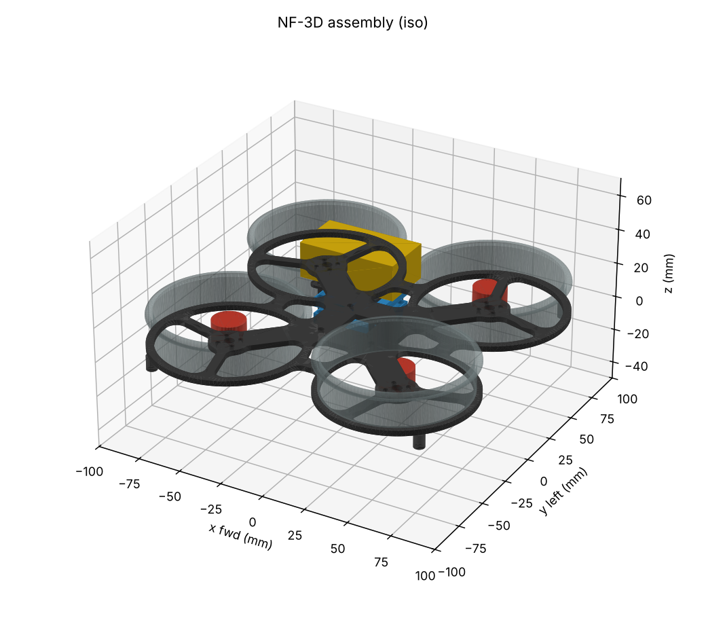

# drone-design: NF-3D

A complete small quadcopter designed entirely in code, in a cloud container. It is built around the
[neuroflight-fc](https://github.com/Ashtonantony28/neuroflight-fc) learned flight controller and
flight-tested in that project's simulator.

- **Electronics:** the neuroflight-fc flight controller written in **Zener** with Diode's
  [`pcb`](https://github.com/diodeinc/pcb) toolchain (the E-CAD used in the Fable 5.2 electronics demo),
  laid out and DRC-checked in **KiCad 10**.
- **Mechanics:** a parametric frame in **build123d** (Python CAD), with mass, clearance, FEA and
  manufacturing exports.
- **Validation:** propulsion model, structural FEA and flight simulation, each with pass/fail gates.



## The vehicle

| | |
|---|---|
| Class | 3" ducted quad, 4S, sub-250 g |
| Motor spacing | 100 mm square (141 mm diagonal), widened from neuroflight's 92 mm so the 30.5 mm FC stack clears the ducts |
| All-up weight | **238.8 g** (CAD mass model, requirement ≤ 249 g) |
| Thrust/weight | **5.9** nominal, 4.3 in the pessimistic corner (requirement ≥ 3) |
| Hover | 28 % throttle, **8.8 min** hover (5.3 min pessimistic; requirement ≥ 4) |
| Frame | 3.0 mm carbon unibody with closed ring perimeter, PA12-CF printed ducts, TPU feet |
| FC | STM32H743, ICM-42688-P + BMI270, DPS310, 1 Gbit NAND, 36x36 mm 4-layer, 143 parts |

Every number comes from `spec/vehicle.yaml`. It is the single source that the CAD, mass model,
propulsion model, FEA and flight simulator all read.

## Verify

```
make verify          # mech -> propulsion -> fea -> flight (needs ../neuroflight-fc, torch)
cd ecad && python -m pytest check_design.py check_layout.py -q
docker run --rm -v $PWD:$PWD -w $PWD/ecad kicad/kicad:10.0.8 \
  kicad-cli pcb drc --severity-all boards/nf_fc/layout/nf_fc/nf_fc.kicad_pcb
```

| Check | Result |
|---|---|
| `mech.checks`: interference, clearances ≥ 1 mm, prop tip gap 1.0 mm, prop inside duct, feet are the lowest point, CoG offset | PASS |
| `prop.propulsion`, nominal and pessimistic corners (ct −15 %, cp +20 %, mass +5 %) | PASS |
| `mech.fea`: 20 g single-foot crash | SF **1.53** (≥ 1.5) at 1.6 mm mesh |
| `mech.fea`: full thrust | SF 31 |
| `mech.fea`: first frame mode | 213-221 Hz, 21-32 % away from hover rotor speed (≥ 20 %) |
| `flight.fly`: PID fallback on NF-3D vs the original neuroflight vehicle, 256 randomized vehicles per scenario | PASS (within 3 points in both corners) |
| `pcb build` (Zener) | 143 components, no errors or warnings |
| `ecad/check_design.py` (pin map, decoupling, rails, BOM vs neuroflight-fc) | 9 passed |
| `ecad/check_layout.py` (IMU spacing, DShot length, holes, decoupling, GND plane) | 11 passed |
| KiCad 10 DRC | **0 errors, 0 unconnected**, 43 warnings (42 silkscreen, 1 dangling via) |

The frame took five FEA iterations to pass: crash safety factor 0.5 → 0.95 → 1.27 → 1.45 → 1.7, and
first mode 118 → 221 Hz. The changes were ring bridges, a 3 mm plate, wider arms, a bigger centre body
and filleted arm roots.

## Findings and open items

1. **The neural policy needs retraining for this airframe.** neuroflight's `hover_ctbr_v3` holds up on
   the nominal NF-3D (85.9-99.2 %). On the weak-motor corner it collapses to 34-54 %. A quick
   fine-tune (`flight/retrain.py`, 440 PPO iterations from the exported weights, with no training
   checkpoint available) made it worse. The PID fallback flies both corners as well as it flies the
   original vehicle. Next step: retrain in neuroflight-fc against `out/vehicle_nominal.yaml` with the
   widened randomization in `runs/nf3d_ft/randomization.yaml`. See `out/FLIGHT-REPORT.md`.
2. **PCB before fab:** the USB pair is unmatched (D+ 53 mm vs D− 21 mm), QSPI is not length-matched,
   the 5V and 3V3 feeds are thin tracks and not pours, the silkscreen needs cleanup, and the board is
   routed at the 0.1 mm/0.1 mm minimum with no margin. The router is this repo's own maze router
   (`ecad/layout/autoroute.py`).
3. **Datasheet VERIFY items:** DPS310 / W25N01GV pinouts, LMR36015 variant and land pattern, IMU
   LGA-14 land patterns, crystal load capacitors, and the J2 pinout against the ESC you buy. All are
   marked `VERIFY` in `ecad/`.
4. **Propulsion numbers are estimates** until the M3 thrust stand; the pessimistic corner covers
   them. The arm mode is 21 % from the nominal hover rotor speed. Re-check once real hover rpm is known.

## Layout

```
spec/vehicle.yaml   single source of truth (geometry, parts, materials, motor/prop, requirements)
mech/               build123d frame, checks, FEA (gmsh + scikit-fem), exports -> out/cad/
prop/               battery-ESC-motor-prop model
flight/             flight validation and policy fine-tune in the neuroflight-fc simulator
ecad/               Zener FC design, layout scripts, KiCad board, checks, fab outputs (gerbers, PnP, STEP)
out/                generated reports, CAD exports, vehicle parameter sets
```
